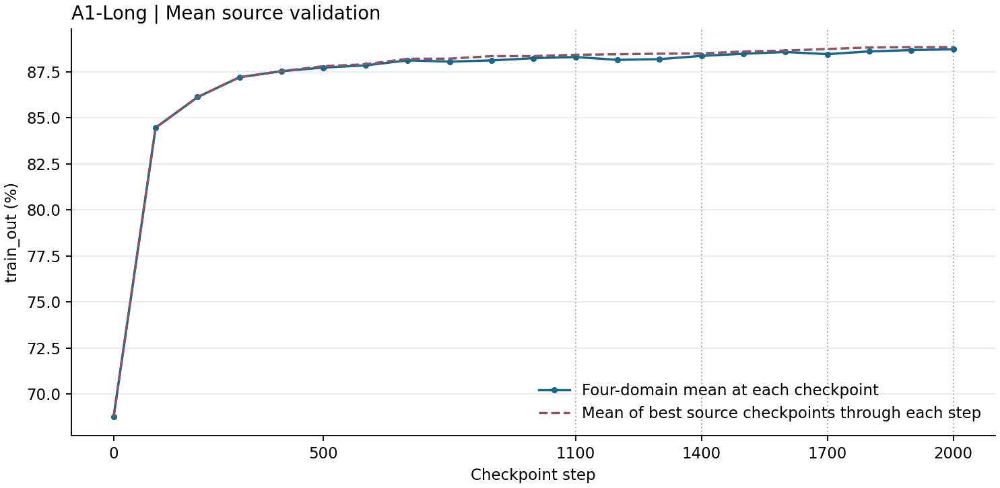
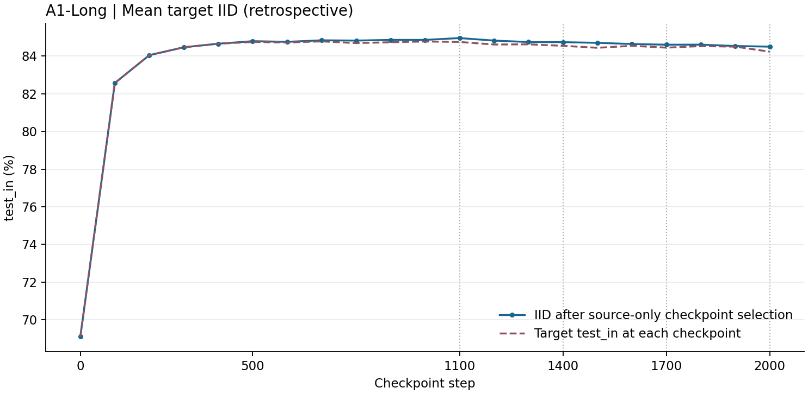
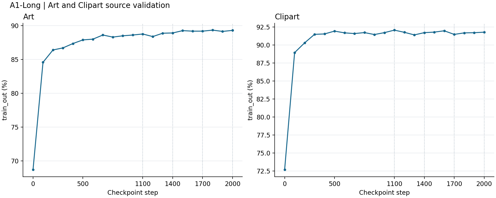

# OfficeHome A1-Long 训练预算验证

四个预算来自同一次 2000 步训练。每个目标域只从截止点以内按源域验证 train_out 选 checkpoint，同分取最早一步。目标域 IID 和 test_out 用于事后报告。

## A1 与 A1-Long 对照

| 实验 | 截止步数 | 平均源域验证 | 相对 A1-Long 1100 的源域变化（百分点） | 平均 IID | 平均 test_out |
|---|---:|---:|---:|---:|---:|
| A1 | 1100 | 88.423% | — | 84.957% | 84.629% |
| A1-Long | 1100 | 88.423% | +0.000 | 84.957% | 84.629% |
| A1-Long | 1400 | 88.497% | +0.074 | 84.739% | 84.132% |
| A1-Long | 1700 | 88.737% | +0.315 | 84.604% | 84.145% |
| A1-Long | 2000 | 88.838% | +0.416 | 84.500% | 83.950% |

## 各目标域选中的 checkpoint

| 实验 | 截止步数 | 目标域 | 选中步数 | 源域验证 | IID | test_out | RD Loss | CLIP Contrastive Loss | 有跨域正样本的 anchor |
|---|---:|---|---:|---:|---:|---:|---:|---:|---:|
| A1 | 1100 | Art | 1100 | 88.761% | 83.986% | 84.330% | 0.0999 | 2.8357 | 63.49% |
| A1 | 1100 | Clipart | 1100 | 92.050% | 71.707% | 70.561% | 0.1035 | 2.5966 | 62.61% |
| A1 | 1100 | Product | 700 | 86.196% | 92.539% | 91.432% | 0.1557 | 3.2266 | 62.19% |
| A1 | 1100 | RealWorld | 900 | 86.683% | 91.595% | 92.193% | 0.1263 | 3.1425 | 63.07% |
| A1-Long | 1100 | Art | 1100 | 88.761% | 83.986% | 84.330% | 0.0999 | 2.8357 | 63.49% |
| A1-Long | 1100 | Clipart | 1100 | 92.050% | 71.707% | 70.561% | 0.1035 | 2.5966 | 62.61% |
| A1-Long | 1100 | Product | 700 | 86.196% | 92.539% | 91.432% | 0.1557 | 3.2266 | 62.19% |
| A1-Long | 1100 | RealWorld | 900 | 86.683% | 91.595% | 92.193% | 0.1263 | 3.1425 | 63.07% |
| A1-Long | 1400 | Art | 1400 | 88.913% | 83.677% | 82.680% | 0.0826 | 2.7250 | 61.90% |
| A1-Long | 1400 | Clipart | 1100 | 92.050% | 71.707% | 70.561% | 0.1035 | 2.5966 | 62.61% |
| A1-Long | 1400 | Product | 1400 | 86.340% | 91.976% | 91.094% | 0.0905 | 3.0109 | 62.32% |
| A1-Long | 1400 | RealWorld | 900 | 86.683% | 91.595% | 92.193% | 0.1263 | 3.1425 | 63.07% |
| A1-Long | 1700 | Art | 1500 | 89.257% | 83.883% | 83.299% | 0.0775 | 2.6963 | 62.79% |
| A1-Long | 1700 | Clipart | 1100 | 92.050% | 71.707% | 70.561% | 0.1035 | 2.5966 | 62.61% |
| A1-Long | 1700 | Product | 1700 | 86.676% | 91.836% | 90.755% | 0.0785 | 2.9254 | 62.67% |
| A1-Long | 1700 | RealWorld | 1600 | 86.965% | 90.993% | 91.963% | 0.0792 | 2.9146 | 61.42% |
| A1-Long | 2000 | Art | 1800 | 89.333% | 83.780% | 83.093% | 0.0680 | 2.5978 | 62.96% |
| A1-Long | 2000 | Clipart | 1100 | 92.050% | 71.707% | 70.561% | 0.1035 | 2.5966 | 62.61% |
| A1-Long | 2000 | Product | 2000 | 86.677% | 91.695% | 90.755% | 0.0705 | 2.8819 | 63.50% |
| A1-Long | 2000 | RealWorld | 1900 | 87.292% | 90.820% | 91.389% | 0.0691 | 2.8272 | 61.08% |

损失和比例取对应 checkpoint 前训练区间的均值。该比例是拥有至少一个同类跨域正样本的 anchor 占比。

## 1100 步后的源域表现

| 目标域 | 1100 以内最佳 | 1100 以后最佳 | 变化（百分点） | 2000 步相对本域峰值（百分点） | 最大相邻变化（百分点） |
|---|---:|---:|---:|---:|---:|
| Art | 88.761% @ 1100 | 89.333% @ 1800 | +0.571 | -0.038 | 0.497 |
| Clipart | 92.050% @ 1100 | 91.958% @ 1600 | -0.093 | -0.284 | 0.501 |
| Product | 86.196% @ 700 | 86.677% @ 2000 | +0.481 | +0.000 | 0.481 |
| RealWorld | 86.683% @ 900 | 87.292% @ 1900 | +0.610 | -0.143 | 0.710 |

逐步四域平均源域验证在 1100 至 2000 步之间于第 2000 步达到 88.722%，到 2000 步回落 0.000 个百分点。最大相邻变化为 0.176 个百分点。平均 E 分类训练损失在 1100 步和 2000 步分别为 0.2443 和 0.1624。
2000 步处仍在该区间的源域验证峰值，未见末段峰值回落。

四个候选预算中最早达到最高源域均值的是 **2000 步**，比 1100 步提高 **0.416 个百分点**。1100 步尚未达到本次轨迹的最佳源域验证表现。较长预算多用 81.8% 的训练步数。可用该预算作为固定的对照，再比较学习率。单条轨迹无法估计不同学习率的收益。

## 复现核验

- Art 的 12 个共同 checkpoint 中，12 个训练及评估指标完全一致，12 个的三项聚合准确率完全一致。加权对比损失对 E adapter 的梯度范数为 0.132864。
- Clipart 的 12 个共同 checkpoint 中，12 个训练及评估指标完全一致，12 个的三项聚合准确率完全一致。加权对比损失对 E adapter 的梯度范数为 0.152667。
- Product 的 12 个共同 checkpoint 中，12 个训练及评估指标完全一致，12 个的三项聚合准确率完全一致。加权对比损失对 E adapter 的梯度范数为 0.121659。
- RealWorld 的 12 个共同 checkpoint 中，12 个训练及评估指标完全一致，12 个的三项聚合准确率完全一致。加权对比损失对 E adapter 的梯度范数为 0.130538。

核对已排除运行时间字段。完整差异、种子重置和梯度证据见 a1_long_verification.json。

## 曲线

